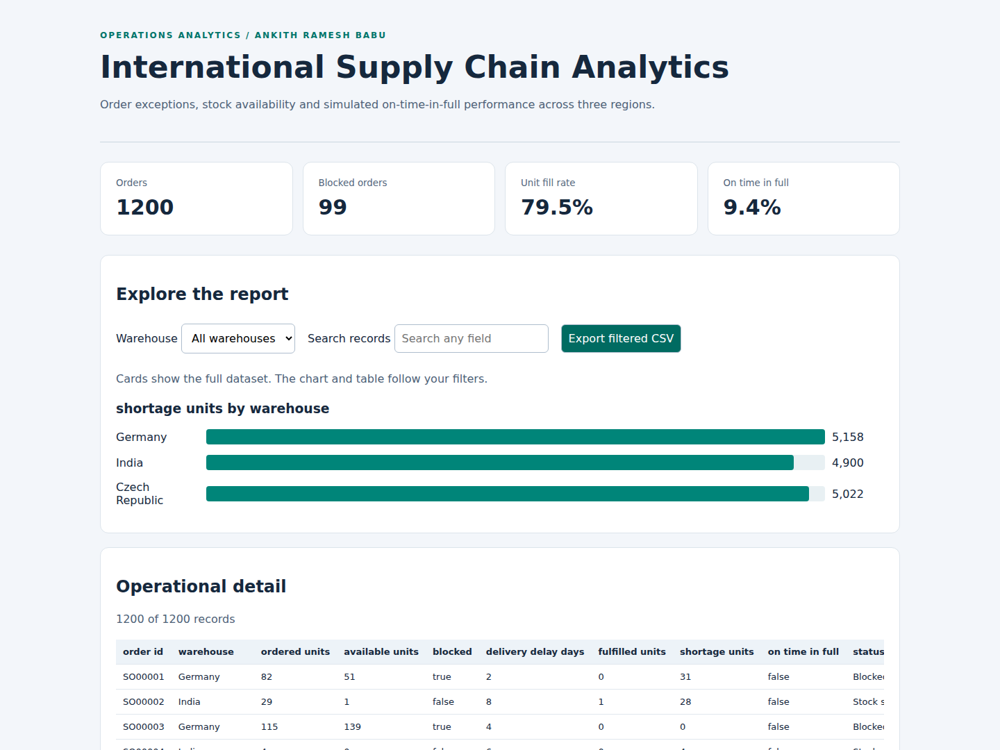

# International Supply Chain Analytics

Order fulfillment analysis across three warehouse regions, with an exception register, regional scorecards and strict on-time-in-full measurement.

**Author:** Ankith Ramesh Babu  
**Scope:** Independent case study using synthetic operational data

**Locations:** Germany, Czech Republic and India

[IEEE-format Report](reports/project-report.pdf) · [Power BI project](powerbi/SupplyChain.pbip) · [Methodology](docs/methodology.md)



## Start Here

1. Read the [IEEE technical report](reports/project-report.pdf) for methods, results and screenshots.
2. Download the repository and open `reports/dashboard.html` for the interactive demonstration.
3. Read the [four-pass verification](docs/verification.md) and [independent numerical audit](reports/numerical_audit.json) for reproducible evidence.

## Key Results

The baseline contains 1,200 orders: 99 blocked orders, 79.48% unit fill rate on unblocked demand, and 9.42% OTIF. The exception register contains 1,087 orders. Availability shortage appears on 752 orders, including 55 blocked orders, while 697 orders receive the primary status Stock shortage.

These results describe the simulation, not an employer operation or measured business savings.

### How to Interpret the Numbers

| Measure | Calculation | Meaning |
| --- | --- | --- |
| Unit fill on released demand | 53,885 / 67,797 = 79.48% | Excludes blocked demand. |
| Unit fill on all demand | 53,885 / 73,285 = 73.53% | Includes the effect of blocks. |
| OTIF | 113 / 1,200 = 9.42% | Complete, unblocked and on-time orders only. |

This is an exception-heavy stress scenario. Its distributions imply about 9.09% expected OTIF, so 9.42% is consistent with the generator. It is not a real company's delivery benchmark. Countries are analytical labels with identical generation rules. No operational savings or service improvement is measured.

## Project Deliverables

- [IEEE-format technical report](reports/project-report.pdf): six-page IEEEtran paper with an abstract, index terms, methodology, results, dashboard screenshots, code excerpts and numbered references.
- [Offline HTML dashboard](reports/dashboard.html): warehouse filter, text search and filtered CSV export. Download the repository to open HTML locally.
- [Warehouse scorecard](reports/warehouse_scorecard.csv): regional fulfillment and OTIF.
- [Power BI source](powerbi/README.md): two report pages, visual definitions, typed semantic model and embedded dataset.
- [Scenario evidence](reports/analysis.json): alternate-seed results.
- [Data dictionary](docs/data-dictionary.md): row definitions, column meanings and aggregation rules.
- [Verification record](docs/verification.md): four audit passes, findings and remaining validation boundaries.
- [SQL audit](sql/kpis.sql): independent KPI calculations from raw CSV fields.
- [Robustness evidence](reports/robustness_check.json): invariant checks across 100 seeds.

## Reproduce the Analysis

Python 3.11 or newer. The analysis has no third-party dependencies.

```bash
git clone https://github.com/ankithr457/international-supply-chain-analytics.git
cd international-supply-chain-analytics
python src/run.py
python scripts/analyze.py
python scripts/build_powerbi.py
python scripts/verify_project.py
python -m unittest discover -s tests -v
```

Open `reports/dashboard.html`. The HTML works offline. Cards display the full dataset. Chart and table filters apply to matching rows, and the CSV export includes every match.

## Power BI Report

Open `powerbi/SupplyChain.pbip` in Power BI Desktop and refresh the embedded data. No local CSV path is required. The report and model are provided as editable source. JSON schemas, embedded-data identity and visual-field references are validated. Power BI Desktop rendering, refresh and DAX execution remain outside the completed verification scope. A PBIX binary is not included.

Regenerate the embedded source after an analysis change:

```bash
python scripts/build_powerbi.py
```

## Scenario Parameters

```bash
python src/run.py --orders 2400 --seed 7 --output reports/scenario
```

## Repository Structure

| Directory | Contents |
| --- | --- |
| `src/` | Simulation, calculations, CSV and HTML generation |
| `scripts/` | Scenario analysis, Power BI and PDF report authoring |
| `tests/` | Business rules, corruption detection, portable builds and model checks |
| `sql/` | Independent KPI queries executed by the audit script |
| `reports/` | Baseline outputs, IEEE-format report and dashboard screenshots |
| `powerbi/` | PBIP, PBIR, semantic model and DAX measures |
| `docs/` | Methodology and validation record |

## Assumptions and Limitations

Inventory is a per-order snapshot rather than a shared stock ledger. Delivery delays and blocks are independently sampled. Unit fill excludes blocked demand, while OTIF uses all orders.

The project does not connect to SAP or execute operational transactions.

## Build the Technical Report

The PDF is compiled from the included IEEEtran conference source. Install TeX Live or MiKTeX, then run:

```bash
python scripts/build_report.py
```

[LaTeX source and build details](docs/ieee/README.md). The report uses an IEEE conference layout and is an independent project report, not an IEEE publication.
